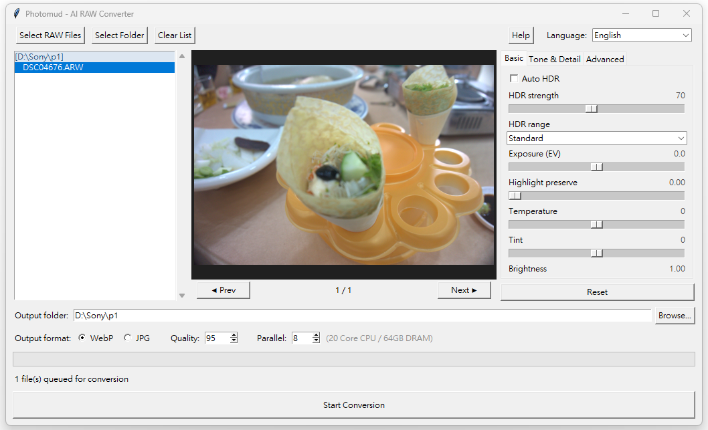

# Photomud - AI RAW Converter

[繁體中文](README.md) | **English**

**A multi-brand camera RAW batch converter: RAW → WebP / JPG**

Version: 5.0.0　|　Website: <https://www.photomud.com>　|　Platform: Windows 10 / 11



---

## Overview

Photomud - AI RAW Converter batch-converts camera RAW photos from many brands to WebP or JPG.

It offers live preview, Auto HDR and 24 adjustments (exposure, white balance, shadows, highlights, noise reduction and more). It processes photos in parallel based on your computer's CPU and memory, and keeps shooting information (EXIF) and color profiles (ICC) in the output files.

## Features

- **Multi-brand RAW support**: 16 brands and 23 RAW file extensions, including the universal DNG format.
- **WebP or JPG output**: WebP by default, with adjustable quality (50–100).
- **Batch conversion**: select multiple files or a whole folder, or drag and drop them onto the window.
- **Live preview**:
  - As soon as you select a photo, the thumbnail embedded in the RAW file appears.
  - The RAW file is then decoded in the background, and the preview switches to the decoded image.
  - The preview scales with the window, and you can switch photos with **◀ Prev** / **Next ▶**.
- **24 adjustments** in three tabs: **Basic**, **Tone & Detail** and **Advanced**. Most adjustments update the preview as you drag. The few that change how the RAW file is decoded re-decode it after you release the slider. Double-click an adjustment's name to reset just that one.
- **Auto HDR**: creates a high-dynamic-range photo from a single RAW file, bringing out shadow detail without blowing out highlights.
- **Automatic parallel processing**: decides how many photos to convert at once based on your CPU cores and available memory.
- **Shooting information kept**: EXIF data such as date taken, camera model, aperture, shutter speed, ISO and GPS is copied to the output files.
- **Color management**: output files include an embedded ICC color profile. sRGB and Adobe RGB are supported.
- **Existing-file handling**: when a file with the same name already exists in the output folder, choose **Skip (default)**, **Overwrite** or **Rename**, and optionally **Apply to all remaining files**.
- **15 interface languages**: chosen automatically from your Windows language, and switchable at any time.
- **Conversion report**: shows how many photos succeeded, were skipped or failed, plus total and average time per photo. Failed files are listed with the reason. The output folder opens automatically when conversion finishes.

## Supported RAW formats

| Brand | Extensions | Notes |
|---|---|---|
| Sony | `.ARW` `.SR2` `.SRF` | `.SR2` and `.SRF` are used by early models |
| Nikon | `.NEF` `.NRW` | `.NRW` is used by Coolpix cameras |
| Fujifilm | `.RAF` | X-Trans models use a dedicated demosaic algorithm |
| Canon | `.CR2` `.CR3` `.CRW` | `.CR3` is used by newer models such as the EOS R series; `.CRW` by models from before 2004 |
| Panasonic | `.RW2` | |
| Olympus / OM System | `.ORF` | |
| DNG | `.DNG` | DJI drones, Leica, Ricoh GR, iPhone ProRAW, Android phones and more |
| Pentax | `.PEF` | |
| Leica | `.RWL` | Most Leica models use `.DNG` |
| Samsung | `.SRW` | NX series |
| Hasselblad | `.3FR` `.FFF` | Medium format |
| Phase One | `.IIQ` | Medium-format digital backs |
| Mamiya | `.MEF` | Medium format |
| Minolta | `.MRW` | |
| Kodak | `.DCR` `.KDC` | |
| Epson | `.ERF` | R-D1 rangefinder |

Sigma `.X3F` is not supported, because the decoding library's support for Foveon sensors is incomplete.

## Interface languages

15 languages, each shown in its own name:

繁體中文 · English · 日本語 · 简体中文 · 한국어 · Français · Italiano · Deutsch · Español · Português (Brasil) · Русский · العربية · हिन्दी · Tiếng Việt · Bahasa Indonesia

At startup, Photomud picks the language that matches your Windows display language. If your system language isn't in the list, it uses English.

## System requirements

- Windows 10 or Windows 11 (64-bit)
- At least 8 GB of memory is recommended. For photos of 24 megapixels or more with Auto HDR turned on, 16 GB or more is recommended.

## Installation

### Download the executable

Download `Photomud.exe` from <https://www.photomud.com> and run it. No Python installation is needed.

### Run from source

Requires Python 3.10–3.12.

```bash
pip install rawpy pillow piexif numpy opencv-python-headless tkinterdnd2
python photomud.py
```

`opencv-python-headless` and `tkinterdnd2` are optional:

- Without OpenCV, Auto HDR, Clarity, Noise reduction and Smoothing are disabled.
- Without tkinterdnd2, drag and drop doesn't work, but you can still select files with the buttons.

### Build the executable yourself

On Windows, run `build_photomud.bat` from the project. It installs the required packages and packages the program with PyInstaller. The executable is created at:

```
dist\Photomud.exe
```

## How to use

1. Click **Select RAW Files** or **Select Folder**, or drag files or a folder onto the window.
2. Adjust settings in the panel on the right. The preview in the middle shows the result as you go.
3. Choose the output format (WebP or JPG), quality and output folder.
4. Click **Start Conversion**.

## Adjustments

### Basic

| Adjustment | Range | Default | Description |
|---|---|---|---|
| Auto HDR | On / Off | Off | Creates a high-dynamic-range photo from a single RAW file (see below) |
| HDR strength | 0–150 | 70 | Above 100, only shadows and midtones are boosted further |
| HDR range | Standard / Strong | Standard | **Strong** raises the limit of the automatic adjustment and lifts shadows further |
| Exposure (EV) | −3.0 to +3.0 | 0 | +1 EV doubles the brightness |
| Highlight preserve | 0–1.0 | 0 | Gently brings overexposed highlights back into range instead of clipping them |
| Temperature | −100 to +100 | 0 | Positive is warmer, negative is cooler |
| Tint | −100 to +100 | 0 | Positive is more magenta, negative is more green |
| Brightness | 0.2–2.0 | 1.0 | 1.0 means no change |
| Contrast | 0.2–2.0 | 1.0 | 1.0 means no change |
| Saturation | 0–2.0 | 1.0 | 1.0 means no change; 0 is black and white |

### Tone & Detail

| Adjustment | Range | Default | Description |
|---|---|---|---|
| Shadows | −100 to +100 | 0 | Brightens (+) or darkens (−) dark areas |
| Highlights | −100 to +100 | 0 | Brightens (+) or recovers (−) bright areas; recovering can bring back sky detail |
| Black point | 0–100 | 0 | Makes blacks deeper and richer |
| Vignette | −100 to +100 | 0 | Darkens (−) or brightens (+) the corners of the frame |
| Clarity | 0–100 | 0 | Increases local contrast for a crisper look |
| Sharpness | 0–2.0 | 1.0 | 1.0 means no change; below 1.0 softens the image |
| Noise reduction | 0–100 | 0 | Reduces both color noise and luminance noise; changing it re-decodes the RAW file |

### Advanced

| Adjustment | Options / Range | Default | Description |
|---|---|---|---|
| White balance | As shot / Auto / Daylight | As shot | Sets the white balance baseline; Temperature and Tint fine-tune from there |
| Color space | sRGB / Adobe RGB | sRGB | The matching ICC color profile is embedded in the output file |
| Gamma curve | BT.709 / sRGB / 2.2 | BT.709 | Changes the overall tonal character |
| Auto brightness | On / Off | On | Automatically brings the image to a suitable brightness |
| Highlight recovery | Clip / Unclip / Blend / Rebuild | Clip | Handles areas where the camera sensor was overexposed |
| Demosaic | AHD / DCB / DHT / AAHD / VNG / PPG / LINEAR | AHD | The algorithm that reconstructs a color image from RAW data. Affects only the output file; the preview doesn't show the difference |
| Smoothing (skin) | 0–100 | 0 | Smooths fine texture while keeping edges sharp |

### Output settings

| Setting | Range | Default |
|---|---|---|
| Output format | WebP / JPG | WebP |
| Quality | 50–100 | 95 |
| Parallel | 1–8 | Calculated from CPU cores and available memory |

The output folder defaults to the folder of the first photo, and can be changed.

## Auto HDR

A RAW file records about 12–14 stops of dynamic range, but JPG and WebP can only show about 8. So a normal conversion either crushes the shadows to black or blows out the highlights.

With **Auto HDR** turned on, Photomud creates three versions from the same RAW file — darker, normal and brighter — and uses exposure fusion to combine the well-exposed parts of each into one photo.

- **Automatic darkening and brightening**: shadows and highlights are calculated separately. For example, night scenes get a strong shadow lift, while bright outdoor scenes mainly have their highlights recovered.
- **Preview matches output**: the small preview and the full-resolution output use exactly the same settings.
- **Limitation**: all the information comes from a single exposure, so areas that were already overexposed on the camera sensor can't be recovered.
- **Performance**: each photo takes a few extra seconds and more memory. Photomud lowers the number of photos converted in parallel based on available memory, to avoid running out.

## Output file information

- **EXIF**: shooting information is copied from the RAW file, and these fields are written:
  - Software: `Photomud - AI RAW Converter v5.0.0`
  - Comment: `Converted by Photomud. https://www.photomud.com`
- **ICC**: an sRGB profile or an Adobe RGB (1998)-compatible profile is embedded, depending on the chosen color space.
- **Orientation**: photos are rotated upright during conversion, so the EXIF orientation tag is set to normal. This keeps photo viewers from rotating them a second time.

## Known limitations

- Canon `.CR2` and Nikon `.NEF` have been fully tested with real photos. The other formats are supported by the LibRaw decoding library but haven't each been tested with sample files.
- Some newer compressed DNG variants (some iPhone ProRAW files and newer DJI models) may fail to decode. When that happens, the file is reported as failed with the reason, and the other files are converted as usual.
- Colors are decoded with the open-source LibRaw library, not the camera maker's color engine, so in-camera color styles such as Fujifilm Film Simulations can't be reproduced.
- When Arabic is selected, the interface layout isn't mirrored right to left; only the text changes.

## Open-source packages used

| Package | Purpose | License |
|---|---|---|
| [rawpy](https://github.com/letmaik/rawpy) | RAW decoding (Python interface) | MIT |
| [LibRaw](https://www.libraw.org/) | RAW decoding engine (included with rawpy) | LGPL 2.1 or CDDL 1.0 |
| [Pillow](https://python-pillow.org/) | Image processing, saving and color management | MIT-CMU |
| [NumPy](https://numpy.org/) | Numerical computing | BSD 3-Clause |
| [OpenCV](https://opencv.org/) (opencv-python-headless) | Exposure fusion, clarity, noise reduction, smoothing | Apache 2.0 |
| [piexif](https://github.com/hMatoba/Piexif) | EXIF reading and writing | MIT |
| [tkinterdnd2](https://github.com/Eliav2/tkinterdnd2) | Drag and drop | MIT |
| [PyInstaller](https://pyinstaller.org/) | Building the executable | GPL 2.0 (with bootloader exception) |

<!-- License for this project: to be added (e.g. MIT, Apache 2.0, or all rights reserved) -->

---

Website: <https://www.photomud.com>
