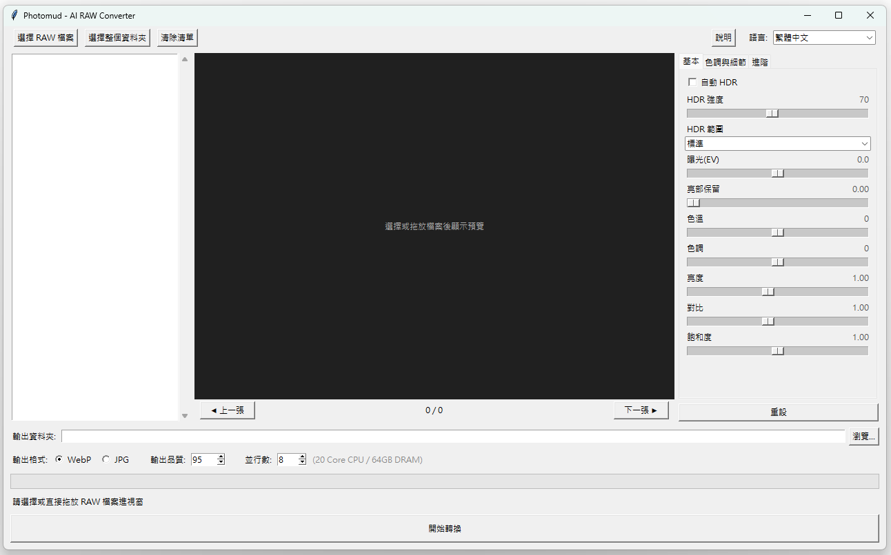

# Photomud - AI RAW Converter

**繁體中文** | [English](README.en.md)

**多廠牌相機 RAW 檔批次轉換工具：RAW → WebP / JPG**

版本：5.0.0　｜　官網：<https://www.photomud.com>　｜　平台：Windows 10 / 11




---

## 簡介

Photomud - AI RAW Converter 是一款多廠牌相機 RAW 檔轉換工具，可以把 RAW 照片批次轉換成 WebP 或 JPG。

它內建即時預覽、自動 HDR 和 24 項調整（曝光、白平衡、陰影、亮部、降噪等），會依電腦的 CPU 和記憶體自動並行處理，輸出時也會保留拍攝資訊（EXIF）和色彩描述檔（ICC）。

## 主要功能

- **多廠牌 RAW 支援**：16 個廠牌、23 種 RAW 副檔名，包含通用的 DNG 格式。
- **輸出 WebP 或 JPG**：預設 WebP，品質可調整（50～100）。
- **批次轉換**：可以一次選取多個檔案、整個資料夾，或直接拖放到視窗。
- **即時預覽**：
  - 選取照片後，馬上顯示 RAW 內嵌的縮圖。
  - 背景接著做 RAW 解碼，完成後換成解碼後的預覽。
  - 預覽會依視窗大小自動縮放，可以用「上一張／下一張」切換。
- **24 項調整**：分成「基本」、「色調與細節」、「進階」三個分頁。大部分調整拖動時預覽就會更新；少數會改變 RAW 解碼方式的調整，放開滑桿後會重新解碼。雙擊任一項的名稱，可以單獨恢復預設值。
- **自動 HDR**：從單張 RAW 合成高動態範圍的照片，暗部細節出得來，亮部也不會過曝。
- **自動並行處理**：依電腦的 CPU 核心數和可用記憶體，自動決定一次轉換幾張。
- **保留拍攝資訊**：拍攝日期、相機型號、光圈、快門、ISO、GPS 等 EXIF 資料，會一起寫入輸出檔。
- **色彩管理**：輸出檔會嵌入 ICC 色彩描述檔，支援 sRGB 和 Adobe RGB。
- **同名檔案處理**：輸出資料夾已經有同名檔案時，可以選擇跳過、覆蓋或改名（預設跳過），也可以勾選「套用到剩餘所有檔案」。
- **15 種介面語言**：啟動時依 Windows 的語言自動選擇，也可以隨時切換。
- **轉換完成報告**：顯示成功、跳過、失敗的張數、總耗時和每張平均時間；失敗的檔案會列出原因。完成後會自動開啟輸出資料夾。

## 支援的 RAW 格式

| 廠牌 | 副檔名 | 備註 |
|---|---|---|
| Sony | `.ARW` `.SR2` `.SRF` | `.SR2`、`.SRF` 是早期機型的格式 |
| Nikon | `.NEF` `.NRW` | `.NRW` 是 Coolpix 系列的格式 |
| Fujifilm | `.RAF` | X-Trans 機型使用專用的去馬賽克演算法 |
| Canon | `.CR2` `.CR3` `.CRW` | `.CR3` 是 EOS R 系列等新機型的格式，`.CRW` 是 2004 年以前的機型 |
| Panasonic | `.RW2` | |
| Olympus / OM System | `.ORF` | |
| DNG | `.DNG` | DJI 空拍機、Leica、Ricoh GR、iPhone ProRAW、Android 手機等 |
| Pentax | `.PEF` | |
| Leica | `.RWL` | Leica 多數機型使用 `.DNG` |
| Samsung | `.SRW` | NX 系列 |
| Hasselblad | `.3FR` `.FFF` | 中片幅 |
| Phase One | `.IIQ` | 中片幅數位機背 |
| Mamiya | `.MEF` | 中片幅 |
| Minolta | `.MRW` | |
| Kodak | `.DCR` `.KDC` | |
| Epson | `.ERF` | R-D1 旁軸相機 |

Sigma `.X3F` 沒有支援，因為解碼函式庫對 Foveon 感光元件的支援不完整。

## 介面語言

共 15 種，以各語言的母語名稱顯示：

繁體中文 · English · 日本語 · 简体中文 · 한국어 · Français · Italiano · Deutsch · Español · Português (Brasil) · Русский · العربية · हिन्दी · Tiếng Việt · Bahasa Indonesia

程式啟動時會依 Windows 的介面語言自動選擇；如果系統語言不在清單裡，預設為英文。

## 系統需求

- Windows 10 或 Windows 11（64 位元）
- 建議至少 8 GB 記憶體。轉換 2,400 萬像素以上的照片並開啟自動 HDR 時，建議 16 GB 以上。

## 安裝

### 下載執行檔

到官網 <https://www.photomud.com> 下載 `Photomud.exe`，直接執行即可，不需要安裝 Python。

### 從原始碼執行

需要 Python 3.10～3.12。

```bash
pip install rawpy pillow piexif numpy opencv-python-headless tkinterdnd2
python photomud.py
```

`opencv-python-headless` 和 `tkinterdnd2` 是選用套件：

- 沒有安裝 OpenCV 時，自動 HDR、清晰度、降噪、平滑這幾項會停用。
- 沒有安裝 tkinterdnd2 時，無法拖放檔案，但仍然可以用按鈕選檔。

### 自行打包成執行檔

在 Windows 上執行專案中的 `build_photomud.bat`。它會先安裝所需套件，再用 PyInstaller 打包，完成後的執行檔在：

```
dist\Photomud.exe
```

## 使用方式

1. 按「選擇 RAW 檔案」或「選擇整個資料夾」，也可以直接把檔案或資料夾拖進視窗。
2. 在右側面板調整參數，中間的預覽會即時顯示效果。
3. 選擇輸出格式（WebP 或 JPG）、輸出品質和輸出資料夾。
4. 按「開始轉換」。

## 調整項

### 基本

| 參數 | 範圍 | 預設 | 說明 |
|---|---|---|---|
| 自動 HDR | 開／關 | 關 | 用單張 RAW 合成高動態範圍照片（見下方說明） |
| HDR 強度 | 0～150 | 70 | 超過 100 時，只加強暗部和中間調 |
| HDR 範圍 | 標準／強 | 標準 | 「強」會放寬自動判斷的上限，暗部也會再多提亮 |
| 曝光（EV） | −3.0～+3.0 | 0 | +1 EV 等於亮度加倍 |
| 亮部保留 | 0～1.0 | 0 | 把過曝的亮部柔和地壓回範圍內，不直接裁切 |
| 色溫 | −100～+100 | 0 | 正值偏暖，負值偏冷 |
| 色調 | −100～+100 | 0 | 正值偏洋紅，負值偏綠 |
| 亮度 | 0.2～2.0 | 1.0 | 1.0 為不變 |
| 對比 | 0.2～2.0 | 1.0 | 1.0 為不變 |
| 飽和度 | 0～2.0 | 1.0 | 1.0 為不變，0 為黑白 |

### 色調與細節

| 參數 | 範圍 | 預設 | 說明 |
|---|---|---|---|
| 陰影 | −100～+100 | 0 | 提亮（+）或壓暗（−）暗部區域 |
| 亮部 | −100～+100 | 0 | 提亮（+）或壓回（−）亮部區域，壓回可以救回天空細節 |
| 黑點 | 0～100 | 0 | 讓黑色更深、更紮實 |
| 暈邊 | −100～+100 | 0 | 壓暗（−）或提亮（+）畫面四角 |
| 清晰度 | 0～100 | 0 | 加強局部對比，讓畫面更通透 |
| 銳利度 | 0～2.0 | 1.0 | 1.0 為不變，低於 1.0 會變柔 |
| 降噪 | 0～100 | 0 | 同時處理彩色雜訊和亮度雜訊；調整後會重新解碼 RAW |

### 進階

| 參數 | 選項／範圍 | 預設 | 說明 |
|---|---|---|---|
| 白平衡 | 相機設定／自動／日光 | 相機設定 | 決定白平衡的基準，色溫和色調再從這個基準微調 |
| 色彩空間 | sRGB／Adobe RGB | sRGB | 輸出檔會嵌入對應的 ICC 色彩描述檔 |
| Gamma 曲線 | BT.709／sRGB／2.2 | BT.709 | 改變整體的明暗調性 |
| 自動亮度 | 開／關 | 開 | 自動把畫面拉到適當的亮度 |
| 亮部重建 | 裁切／不裁切／混合／重建 | 裁切 | 處理感光元件已經過曝的區域 |
| 去馬賽克 | AHD／DCB／DHT／AAHD／VNG／PPG／LINEAR | AHD | 決定 RAW 還原成彩色影像的演算法。只影響輸出檔，預覽看不出差別 |
| 平滑（柔膚） | 0～100 | 0 | 抹平細紋，同時保留輪廓邊緣 |

### 輸出設定

| 參數 | 範圍 | 預設 |
|---|---|---|
| 輸出格式 | WebP／JPG | WebP |
| 輸出品質 | 50～100 | 95 |
| 並行數 | 1～8 | 依 CPU 核心數和可用記憶體自動計算 |

輸出資料夾預設是第一張照片所在的資料夾，可以自行更改。

## 自動 HDR

RAW 檔記錄了大約 12～14 級的動態範圍，但 JPG 和 WebP 只能呈現大約 8 級。所以一般轉檔時，不是暗部變成一片黑，就是亮部過曝。

開啟「自動 HDR」後，Photomud 會從同一張 RAW 算出一暗、一般、一亮三個版本，再用曝光融合，從每個版本挑出曝光正確的區域合成一張。

- **自動決定壓暗和提亮的幅度**：暗部和亮部分開計算。例如夜景會大幅提亮暗部；明亮的戶外場景則以壓回亮部為主。
- **預覽和輸出一致**：預覽小圖和全解析度輸出，算出的幅度完全相同。
- **限制**：所有資訊都來自同一次曝光，所以拍攝當下感光元件已經過曝的地方，還是救不回來。
- **效能**：開啟後每張照片的處理時間會增加數秒，記憶體用量也會增加。程式會依可用記憶體自動降低並行數，避免記憶體不足。

## 輸出檔案資訊

- **EXIF**：從 RAW 移植拍攝資訊，並寫入：
  - 程式名稱：`Photomud - AI RAW Converter v5.0.0`
  - 註解：`Converted by Photomud. https://www.photomud.com`
- **ICC**：依選擇的色彩空間，嵌入 sRGB 或 Adobe RGB (1998) 相容的描述檔。
- **方向**：轉換時已經把照片轉正，所以 EXIF 的方向標籤會設為正常，避免看圖軟體再旋轉一次。

## 已知限制

- 實際用照片完整測試過的格式是 Canon `.CR2` 和 Nikon `.NEF`。其他格式都在解碼函式庫 LibRaw 的支援範圍內，但還沒有逐一用樣本實測。
- 少數較新的 DNG 壓縮格式（部分 iPhone ProRAW、DJI 新機型）可能無法解碼。遇到時，轉換會記為失敗並顯示原因，其餘檔案照常處理。
- 色彩是依開源的 LibRaw 解碼，不是相機原廠的色彩引擎，所以無法重現原廠的色彩風格，例如富士的底片模擬。
- 選擇阿拉伯文時，介面不會左右鏡像翻轉，只有文字會換成阿拉伯文。

## 使用的開源套件

| 套件 | 用途 | 授權 |
|---|---|---|
| [rawpy](https://github.com/letmaik/rawpy) | RAW 解碼（Python 介面） | MIT |
| [LibRaw](https://www.libraw.org/) | RAW 解碼核心（rawpy 內含） | LGPL 2.1 或 CDDL 1.0 |
| [Pillow](https://python-pillow.org/) | 影像處理與存檔、色彩管理 | MIT-CMU |
| [NumPy](https://numpy.org/) | 數值運算 | BSD 3-Clause |
| [OpenCV](https://opencv.org/)（opencv-python-headless） | 曝光融合、清晰度、降噪、平滑 | Apache 2.0 |
| [piexif](https://github.com/hMatoba/Piexif) | EXIF 讀寫 | MIT |
| [tkinterdnd2](https://github.com/Eliav2/tkinterdnd2) | 檔案拖放 | MIT |
| [PyInstaller](https://pyinstaller.org/) | 打包成執行檔 | GPL 2.0（附 bootloader 例外條款） |

<!-- 本專案授權條款:待補(例如 MIT、Apache 2.0 或保留所有權利) -->

---

官網：<https://www.photomud.com>
